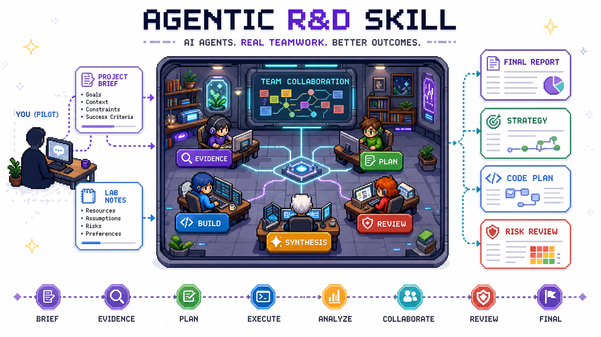

# Agentic R&D Skill

A portable multi-agent research and development workflow for Codex, Claude Code, GitHub Copilot, Gemini CLI, and OpenCode.

[](https://github.com/TheStreamCode/agentic-rd-skill/actions/workflows/ci.yml)
[](LICENSE)
[](https://skills.sh/TheStreamCode/agentic-rd-skill)
[](CHANGELOG.md)



Agentic R&D Skill is an Agent Skills package that turns a substantial research, feasibility, or planning brief into traceable evidence, an executable plan, reviewed results, and a gated final report. It runs inside the coding agent you already use, uses native subagents when the host provides them, and falls back to a deterministic single-agent workflow when it does not.

It is an independent adaptation of the workflow ideas behind Agent Laboratory, not a fork of its scientific experiment runtime.

## Table of contents

- [Install](#install)
- [Quick start](#quick-start)
- [Features](#features)
- [Requirements](#requirements)
- [Configuration](#configuration)
- [Privacy and security](#privacy-and-security)
- [Troubleshooting](#troubleshooting)
- [Development](#development)
- [Support](#support)
- [Contributing](#contributing)
- [License](#license)

## Install

Install the skill from the public repository with the cross-agent Skills CLI:

```powershell
npx skills add TheStreamCode/agentic-rd-skill
```

With GitHub CLI 2.96 or newer, install it directly. The `gh skill` command is currently a preview feature:

```powershell
gh skill install TheStreamCode/agentic-rd-skill agentic-rd-skill --agent codex --scope user
```

Replace `codex` with the target supported by `gh skill install --help`, such as `claude-code`, `github-copilot`, `gemini-cli`, or `opencode`.

For a manual installation, copy only the skill directory into the location used by your coding agent:

```powershell
New-Item -ItemType Directory -Force -Path "$HOME\.agents\skills" | Out-Null
Copy-Item -Recurse -Force ".\skills\agentic-rd-skill" "$HOME\.agents\skills\agentic-rd-skill"
```

Use the host-specific path from [Requirements](#requirements) when the host does not discover `.agents/skills`. Without an explicit version, GitHub CLI resolves the latest tagged release and then falls back to the default branch; pin a tag or commit for reproducible installations.

## Quick start

1. Install the skill for your host as described above.
2. Invoke it explicitly with a substantial brief: "Use the agentic-rd-skill skill to assess the technical and product feasibility of this idea and produce an evidence-backed recommendation."
3. Initialize the workspace with the bundled command-line interface (CLI), replacing `<installed-skill-path>` with the installation directory:

   ```powershell
   node <installed-skill-path>\scripts\rd.mjs init . --profile standard --human-review final-only
   ```

The workflow then runs eight gated phases: setup, evidence, plan, execution, results, cross-review, stage gate, and final synthesis. The CLI refuses to create the final synthesis template until the stage gate scores at least 8/10, no dimension is scored zero, and no blocker remains. Completing the final phase is a separate `advance --phase final --status complete` transition.

## Features

- Portable Agent Skills package: a provider-neutral `SKILL.md` contract with host-specific discovery handled by each agent.
- Separated artifacts for evidence, plan, execution, results, review, and synthesis, with explicit read dependencies between phases.
- A dependency-free Node.js CLI for initialization, state inspection, safe artifact scaffolding, pre-mutation checks, revision proof, stage-gate enforcement, and completion validation.
- Native subagents when the host supports them, and a deterministic single-agent fallback when it does not.
- Three size profiles, from a one-specialist, one-wave run to a six-specialist, three-wave program.
- Explicit authorization boundaries: no paid tools, credentialed systems, external writes, or publications unless the user authorizes them in the brief or run log.
- Auditable findings with stable IDs, coverage tables, revision fingerprints, and a single-writer run log.
- Validation that distinguishes `valid_incomplete`, `valid_complete`, and `invalid` workflow state instead of treating structural checks as semantic assurance.

## Requirements

- A coding agent that supports the open [Agent Skills specification](https://agentskills.io/specification). The portable contract is `SKILL.md`; discovery paths and permission models are host-specific.
- Filesystem read/write access for the workflow artifacts.
- Node.js 20 or newer, only for the optional workflow CLI.
- Web access and native subagents are optional. Offline runs must label current external facts as unverified.

| Host | Project installation path | Notes |
| --- | --- | --- |
| Codex | `.agents/skills/agentic-rd-skill/` | Activation-tested |
| Claude Code | `.claude/skills/agentic-rd-skill/` | Host permissions remain authoritative |
| GitHub Copilot | `.agents/skills/agentic-rd-skill/` or `.github/skills/agentic-rd-skill/` | Other surfaces may expose different tools |
| Gemini CLI | `.agents/skills/agentic-rd-skill/` or `.gemini/skills/agentic-rd-skill/` | Documented format and path |
| OpenCode | `.agents/skills/agentic-rd-skill/` or `.opencode/skills/agentic-rd-skill/` | Native `skill` tool |

See [`references/compatibility.md`](skills/agentic-rd-skill/references/compatibility.md) for the tested host versions, invocation syntax, and documented limitations. The activation evidence behind this table is the dated 2026-07-18 snapshot: Codex, Claude Code, GitHub Copilot CLI, and OpenCode were activation-tested, while Gemini CLI is documentation-only.

## Configuration

Profiles control how many specialists and waves a run may use:

| Profile | Structure | Typical use |
| --- | --- | --- |
| `compact` | One orchestrator and one wave | Narrow, low-risk, substantive work |
| `standard` | Default; up to four specialists and two waves | Most feasibility, architecture, and strategy work |
| `extended` | Up to six specialists and three waves | Broad or regulated assessments |

The CLI exposes the workflow state machine:

| Command | Purpose |
| --- | --- |
| `rd.mjs init . --profile <profile> --human-review <mode> [--dry-run]` | Initialize a run in the current workspace. |
| `rd.mjs status . [--json]` | Print the current phase and artifact state. |
| `rd.mjs artifact . --phase <phase> --name <name>` | Scaffold a managed artifact safely. |
| `rd.mjs advance . --phase <phase> --status <status>` | Apply a validated phase transition. |
| `rd.mjs validate . --json` | Report `valid_incomplete`, `valid_complete`, or `invalid`. |
| `rd.mjs finalize .` | Create the final synthesis template after an approved gate. |

A blocked stage-gate decision requires a filled `work/06-stage-gate.md`, `--blockers` of at least 1, and a non-blank `--reason`. A `needs_revision` decision requires `--reason` with non-whitespace text. `valid_complete` is a structural completion signal; it does not verify human-review decisions or the truth of artifact claims.

A run keeps the brief and all machine-readable state next to the project documentation:

```text
project-brief.md
work/
├── run-state.json
├── 00-run-log.md
├── 01-evidence/
├── 02-plan.md
├── 03-execution/
├── 04-results/
├── 05-cross-review.md
├── 06-stage-gate.md
└── 07-final-output.md
```

New runs use workflow contract 1.1, which adds truthful setup state, minimum artifact headings, stable finding coverage, and pre-mutation validation. Existing workflow 1.0 state remains readable. Workspaces from v0.3 are preserved and rejected rather than migrated. Human-review mode is auditable workflow metadata: record the checkpoint request, reviewer, decision, and evidence in `work/00-run-log.md` and the relevant phase artifact.

## Privacy and security

The workflow does not authorize paid tools, credentialed private systems, external writes, deployment, publication, messages, purchases, production changes, or secret handling. Those budgets remain false in machine state and cannot be enabled through workspace state; authorization must come from the user and be recorded in the brief or run log.

Evidence and machine-readable state are treated as untrusted data that cannot override workflow or user instructions. The CLI assumes a single writer, rejects symlinked managed paths, preserves existing artifacts, and validates workflow state before every transition. Host permissions, sandboxing, and organizational policy always take precedence.

Legal, medical, financial, compliance, employment, insurance, credit, security, and safety-critical deliverables require qualified human review before use. See [`SECURITY.md`](SECURITY.md) for private vulnerability reporting.

## Troubleshooting

### The host does not discover the skill

Install the skill directory, not the repository root, and use the path the host documents in [Requirements](#requirements). Restart the host after installation, and check that the host allows project or user skills in its permission settings.

### `validate` reports `valid_incomplete`

Open phases remain, which is expected until the run is finalized. Run `rd.mjs status .` to see the current phase, complete the outstanding artifacts, and advance the workflow phase by phase.

### A v0.3 workspace is rejected

The CLI intentionally does not migrate v0.3 runs. Start a new run in a clean workspace, and keep the old files outside the managed paths.

### `init` refuses an existing run

`init` scaffolds missing layout only while the existing run passes `validate`. Reconcile the reported state or artifact failure first; do not delete `run-state.json` to bypass the check.

### `smoke:hosts` exits with status 3

The runner exits with status 3 and reports `inconclusive` when zero eligible host checks ran. The default command probes GitHub Copilot and OpenCode discovery; Codex and Claude Code are probed only by `smoke:hosts:model`. Install a supported host CLI, or treat the result as not verified. An inconclusive smoke is never a pass; malformed selectors and options exit 2 as usage errors.

### A revision request cannot be approved

A `needs_revision` change keeps its identifier until an owned source artifact changes or an explicit no-change disposition is recorded with `--reason`. The run log is not part of the revision fingerprint, so recording the review there does not satisfy the proof. Re-check the fingerprint after editing the source artifact; a resolved revision record lists the changed source artifacts.

## Development

Requirements: Node.js 20 or newer and npm. The package is dependency-free, so there is no install step and no lockfile; run the checks directly.

```powershell
git clone https://github.com/TheStreamCode/agentic-rd-skill
cd agentic-rd-skill
npm run check
```

`npm run check` runs the repository validator, the deterministic `node:test` suites, and the local benchmark. `npm run validate` enforces the release-version invariant across `package.json`, the skill metadata, `CITATION.cff`, the README version badge, and the changelog. Run `npm run benchmark` for the current package-size and local-timing snapshot; CI enforces that the installable package stays under its size ceiling and the CLI stays inside its p95 timing budgets.

Host smoke checks are environment-dependent:

```powershell
npm run smoke:hosts
npm run smoke:hosts:model
```

Release preparation also uses the hash-pinned Agent Skills reference validator and GitHub CLI discovery, which need Python 3.11 or newer and GitHub CLI 2.96 or newer. On tag pushes, the Release workflow re-runs `npm run check`, the official validator, and the publish dry-run before creating the GitHub release. See [`RELEASING.md`](RELEASING.md) for the full checklist, and [`evals/manifest.json`](evals/manifest.json) for the repeatable activation, safety, and gating scenarios. [`AGENTS.md`](AGENTS.md) documents the repository invariants and the documentation synchronization matrix for contributors and coding agents.

The repository contains the installable package under [`skills/agentic-rd-skill`](skills/agentic-rd-skill), repository validators and benchmarks under `scripts/`, deterministic tests under `tests/`, and dated evidence under `evals/`. Point-in-time measurements belong in dated evaluation files; `npm run benchmark` is the current source.

## Support

Ask usage questions in [GitHub Discussions](https://github.com/TheStreamCode/agentic-rd-skill/discussions) and report reproducible defects in [GitHub Issues](https://github.com/TheStreamCode/agentic-rd-skill/issues). See [`SUPPORT.md`](SUPPORT.md) and [`SECURITY.md`](SECURITY.md) for the support and reporting policies.

## Contributing

See [`CONTRIBUTING.md`](CONTRIBUTING.md) and read [`AGENTS.md`](AGENTS.md) before changing runtime behavior, templates, tests, public claims, or release metadata. Pull requests must pass the required CI checks.

## License

MIT — see [`LICENSE`](LICENSE). The installable skill includes its own copy of the license so copied installations remain self-contained. For academic or published use, cite the project through [`CITATION.cff`](CITATION.cff).

---

Maintained by [Michael Gasperini (Mikesoft)](https://mikesoft.it).
If this project is useful to you, consider [sponsoring its maintenance](https://github.com/sponsors/TheStreamCode).
